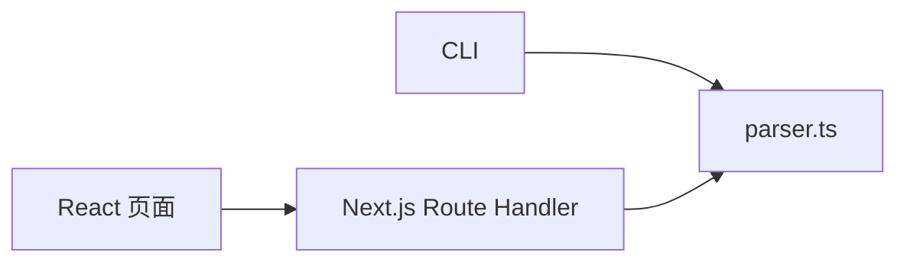

# JSON / YAML / XML 解析器架构

独立的 Next.js 全栈应用：同一进程提供页面与 `POST /api/parse`。核心逻辑在 `src/lib/parser.ts`（`detect` / `parse`），CLI 为 `npm run cli -- parse <file>`。

- JSON：`JSON.parse`
- YAML：`yaml` 包，仅单文档；空文档为 `null`；经 JSON 往返规范化
- XML：自定义栈式解析；`$attributes` / `$text`；重复兄弟节点为数组；拒绝 DTD/指令、多根、嵌套超过 256

请求体为 `{"source":"...","format":"json|yaml|xml"}`，成功 `{format,data,sourcePath?}`，失败 `400 {error:{message}}`。
