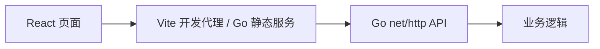

# JSON / YAML / XML 解析器架构



前后端通过 JSON HTTP 接口通信，前端不依赖 Node.js 服务端。每个项目独立安装、构建和运行。Go 模块与 npm 锁文件分开维护，CI 对五个项目分别执行 Go 检查及前端构建。

Go 库提供 `Detect(path, format)` 和 `Parse(source, path, format)`。支持按扩展名判断格式和显式覆盖。CLI 将数据输出为格式化 JSON。

```sh
go run ./cmd/data-parser parse input.yaml
go run ./cmd/data-parser parse input.txt --format xml
```

网页使用 `POST /api/parse`，请求体为 `{"source":"name: Ada","format":"yaml"}`。XML 属性保存为 `$attributes`、文本为 `$text`、重复元素为数组。拒绝格式错误、多根 XML、DTD 指令、超过 256 层 XML 和多文档 YAML。YAML 映射键必须能转换为 JSON 对象键。请求体限制为 1 MiB。
