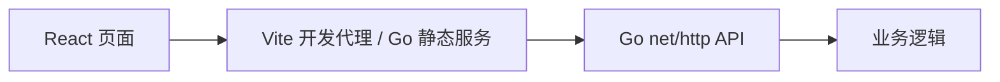

# 文件搜索架构



前后端通过 JSON HTTP 接口通信，前端不依赖 Node.js 服务端。每个项目独立安装、构建和运行。Go 模块与 npm 锁文件分开维护，CI 对五个项目分别执行 Go 检查及前端构建。

Go 库提供 `Files(ctx, Options)`；CLI 保留 `search <keyword> --root <directory> --max <number>`，也支持 `-r`、`-m`。匹配不区分大小写，按目录字典序遍历，忽略 `.git`、`node_modules`、`dist`、`coverage`，不跟随符号链接。根目录或子目录读取失败均返回错误，不返回部分结果；`errors.Is(err, search.ErrIncomplete)` 可识别遍历失败。请求取消会停止遍历。

```sh
go run ./cmd/file-search search readme --root . --max 20
```

网页通过 `POST /api/search` 搜索 `SEARCH_ROOT`（默认当前项目目录）。请求体为 `{"query":"readme","max":50}`，最多 1000 条，返回相对路径。浏览器不能任意指定服务端路径。
