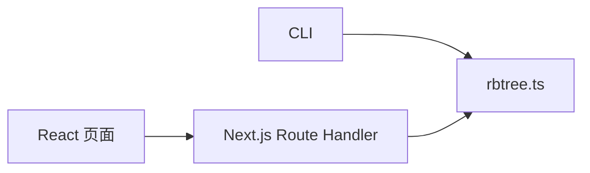

# 红黑树随机排序架构



前后端由同一 Next.js 进程提供：页面在 `src/app/`，接口为 `POST /api/sort`。核心逻辑在 `src/lib/rbtree.ts`，CLI（`src/cli.ts`）与 API 共用。

左倾红黑树实现 `Tree.insert`、`Tree.values`、`Tree.validate`、`demo(count, seed)`。重复值不插入。`demo` 用确定性 PRNG（xorshift64*）做 Fisher–Yates，打乱后插入 `[0, count)`，再中序遍历并校验红黑树不变量。同一 seed 在本 TypeScript 实现内可复现；不要求与旧 Go PCG 序列一致。

```sh
npm run cli -- --count 10000 --seed 42
```

`POST /api/sort` 接收 `{"count":10000,"seed":42}`，返回：

`elementCount`、`inserted`、`insertTimeMs`、`traversalTimeMs`、`treeHeight`、`rotations`、`recolors`、`validRedBlackTree`、`blackHeight`、`sortedOutput`、`firstValues`、`lastValues`、`validationErrors`。

数量须在 1–1,000,000，否则 400 `{error:{message}}`。`Tree` 构造后即可使用；`stats()` 与 `values()` 返回独立快照，调用者无法通过快照修改内部状态；同一棵树不支持并发修改。
