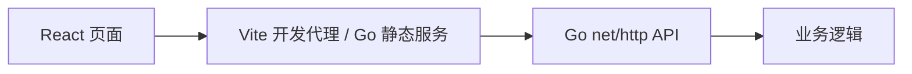

# Trumpet Twitter架构

前后端通过 JSON HTTP 接口通信，前端不依赖 Node.js 服务端。每个项目独立安装、构建和运行。Go 模块与 npm 锁文件分开维护，CI 对五个项目分别执行 Go 检查及前端构建。

React + Vite 保留原有界面和状态机。Go `net/http` + SQLite 实现注册、登录、退出、30 天 Cookie 会话、发帖、回复、关注/取关、点赞/取消点赞、关注时间线、用户主页和游标分页。

数据库文件由 `DB_FILE` 指定（默认 `data/trumpet.db`）。数据库表和 bcrypt 密码哈希沿用旧实现。旧项目默认数据库位于 `apps/api/data/trumpet.db` 时，请备份后通过 `DB_FILE` 指向该文件。密码受 bcrypt 限制，最大 72 字节；账号为 3–20 位小写字母、数字或下划线，帖子最多 280 字。

开发时 Vite 代理 `/api` 到 Go 服务；构建后 Go 同时提供静态前端和 `/api/*`。后端也保留旧版无 `/api` 前缀路由。开发前端端口为 18105。跨源变更请求按 Origin 校验；反向代理部署需设置 `WEB_ORIGIN=https://实际域名`，HTTPS 设置 `COOKIE_SECURE=true`。`.env.example` 是配置参考，Go 不自动加载 `.env`。

首次使用在网页注册账号。也可在空数据库执行 `go run ./cmd/seed`，创建 mina / leo / ava（密码 password123）及演示帖子；数据库非空时拒绝操作，不覆盖数据。侧栏支持按账号查找真实用户。现有前端单元测试与 Go 集成测试覆盖核心流程。

Go 应用通过 `app.Open(file, app.Config{CookieSecure: ..., WebOrigin: ...})` 创建；环境变量只由 `cmd/server` 读取，配置在启动时校验并复制。正常业务和存储失败返回 `error`，HTTP Adapter 统一映射状态码与安全提示。请求 Context 传入所有请求中的 SQL 操作；`SeedDemo(ctx)` 通过事务执行并支持取消。测试使用相同的 HTTP Interface 和真实临时 SQLite，不引入单一实现的仓储 Interface。
