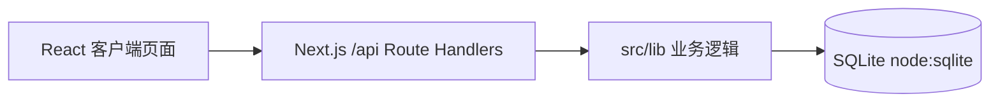

# Trumpet Twitter 架构

前后端同属一个 Next.js 进程：App Router 提供页面，Route Handlers 提供 `/api/*`。依赖与锁文件在本项目根目录维护。

React 保留原有界面和状态机。SQLite（`node:sqlite` DatabaseSync）实现注册、登录、退出、30 天 Cookie 会话、发帖、回复、关注/取关、点赞/取消点赞、关注时间线、用户主页和游标分页。密码使用 `bcryptjs`（cost 12），可校验旧 Go bcrypt 哈希。

数据库文件由 `DB_FILE` 指定（默认 `data/trumpet.db`）。跨源变更请求按 Origin 校验；反向代理部署需设置 `WEB_ORIGIN`，HTTPS 设置 `COOKIE_SECURE=true`。

演示数据：`npm run seed` 仅在空库写入 mina / leo / ava（密码 password123）。

配置通过环境变量读取（见 `.env.example`）；测试可通过 `setConfig` 固定 Cookie/Origin。业务错误以 `{error:{code,message}}` 返回，内部错误统一为 `internal_error`。
