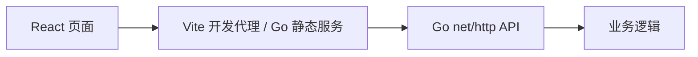

# 贪吃蛇架构

前后端通过 JSON HTTP 接口通信，前端不依赖 Node.js 服务端。每个项目独立安装、构建和运行。Go 模块与 npm 锁文件分开维护，CI 对五个项目分别执行 Go 检查及前端构建。

React 管理游戏生命周期；纯 TypeScript 引擎和 Canvas 渲染器分离。支持方向键 / WASD、Enter 开始、空格暂停、触屏按钮、重新开始、本机最高分。离开页面自动暂停，组件卸载会清理动画与事件监听。

Go 提供 `GET /api/scores` 和 `POST /api/scores`。提交格式为 `{"name":"玩家","score":10}`，按分数保留前 100 条，原子写入 `SCORES_FILE`（默认 `data/scores.json`）。名称 1–40 字；分数必须为 0–5720 的 10 的倍数。

成绩是客户端提交的练习数据，未提供防作弊验证。仅支持单个服务进程写入成绩文件。
